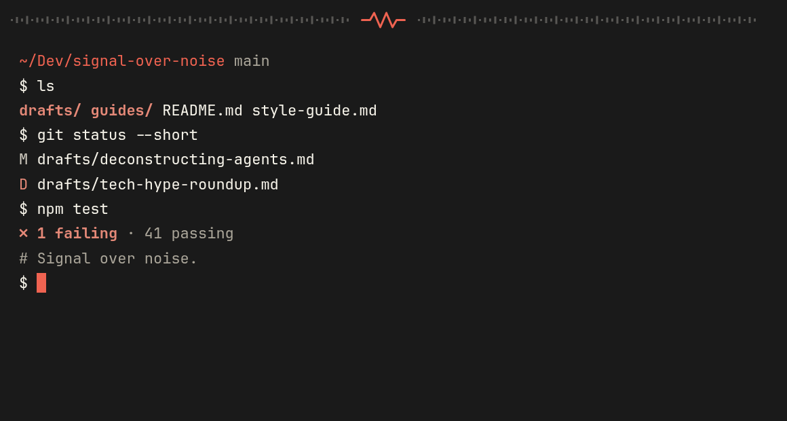
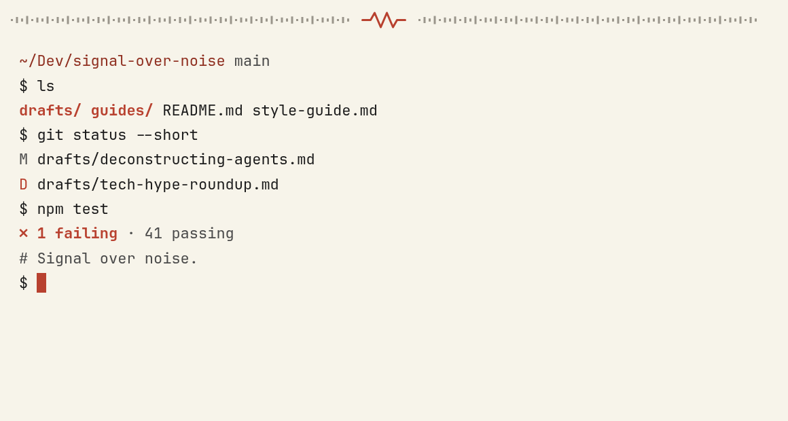

# Signal Over Noise – a one-accent theme for Ghostty




You run `git status`, then your tests, and the screen fills with green, yellow, blue and magenta. Every line is coloured, so the one line that failed has to compete with all the others for your attention.

This theme colours only what needs your attention. Everything else is plain dark text on cream, or cream text on near-black in the dark version, and a single red marks errors, deletions, directories and the cursor. The colours come from [Signal Over Noise](https://go.signalovernoise.at), Jim Christian's newsletter about AI and tech tools, written to cut through the hype.

## The two themes

| Theme | Background | Text | Red |
|---|---|---|---|
| `signal-over-noise-dark` | `#1A1A1A` near-black | `#F7F4EA` cream | `#E58978` for red text, `#EF6351` for the cursor and bright red |
| `signal-over-noise-light` | `#F7F4EA` cream | `#1A1A1A` near-black | `#B8412F` for red text and the cursor, `#8F2F20` for bright red |

The dark theme uses a softer red for text because the brighter one is harder to read in small type on a dark background.

Text colours meet WCAG AA, the usual accessibility standard for contrast (4.5:1 or better). The one exception is the terminal's "black" in the dark theme, which stays faint, as black on a dark background usually does.

The terminal's green, yellow, blue, magenta and cyan are shades of cream or near-black on purpose. Tools that colour-code by hue, such as `git diff`, will show additions as plain text and deletions in red. If you read your terminal by its greens and yellows, this theme will feel quiet at first, and the red will be much easier to spot.

## Install

Clone the repo and copy the two theme files into Ghostty's themes folder:

```bash
git clone https://github.com/aplaceforallmystuff/ghostty-signal-over-noise.git
cd ghostty-signal-over-noise
mkdir -p ~/.config/ghostty/themes
cp signal-over-noise-dark signal-over-noise-light ~/.config/ghostty/themes/
```

Then pick one in your Ghostty config (`~/.config/ghostty/config`):

```
theme = signal-over-noise-dark
```

To follow your system's light or dark setting, name both:

```
theme = light:signal-over-noise-light,dark:signal-over-noise-dark
```

Reload the config with `ctrl+shift+,` (`cmd+shift+,` on macOS), or open a new window. `ghostty +list-themes` shows both themes once they're in place.

## Optional shaders

Ghostty can run small GPU programs, called shaders, over the terminal window. The `shaders/` folder has three in the same style. Each one plays once when you do something, finishes in about a second, and then leaves the screen alone. They only draw on the background, never on your text, and choose the right red for a light or dark theme on their own.

- **`son-break.glsl`**: when a window gains focus, a short line of grey static spreads across the top from the centre, a red pulse draws itself in the middle, and the line clears. It's the divider the newsletter uses between sections.
- **`son-trail.glsl`**: when the cursor moves more than a couple of characters, a red streak runs from where it was to where it landed.
- **`son-ink.glsl`**: when the cursor jumps a long way, such as to another split, a thin line draws under its row from left to right, with a short red tip leading it.

Add any of them to your Ghostty config, one line per shader, with the full path to each file:

```
custom-shader = /path/to/ghostty-signal-over-noise/shaders/son-break.glsl
custom-shader = /path/to/ghostty-signal-over-noise/shaders/son-trail.glsl
```

Each file starts with a few settings you can change, such as timing, strength and how far the cursor has to move. Ghostty only animates shaders in the focused window, so the cost is a little GPU time while an effect plays. If a shader fails to compile, Ghostty skips it and writes the error to its log.

The shaders are tested on Ghostty 1.4 on Linux. They use Ghostty's cursor and focus inputs, which older versions don't have.

## License

MIT, see [LICENSE](LICENSE).

## Author

Jim Christian ([@aplaceforallmystuff](https://github.com/aplaceforallmystuff)) – [Signal Over Noise](https://go.signalovernoise.at)
